# SWIFT-HDC accuracy evaluation — KTH action recognition

Clips: 599 (boxing, handclapping, handwaving, jogging, running, walking); hypervector dimension D = 5024. Main tables: 20 seed sets; sweeps: 10 seed sets. Each seed set redraws all level/position hypervectors, the baseline's random tie-breaks and the validation draw. Quantization ranges come from training clips only. 

Protocols: **5-class notebook** = KTH test persons (2,3,5-10,22, 180 clips) for test, the other 16 persons for training with a random 15 % validation draw (jogging excluded, as in the hdcvideoca notebook). **6-class official** = Schuldt et al. 2004 split: train persons 11-18, validation 1,4,19-21,23-25, test 2,3,5-10,22. **LOPO** = leave-one-person-out over all 25 persons.

## Main results — 5 classes, notebook protocol

Train/val/test clips: 272/47/180; 20 seed sets; mean ± std, 95 % CI of the mean in brackets.

| Configuration | Accuracy (%) | 95 % CI | Balanced acc. | Macro-F1 | Macro-precision | Macro-recall | Top-2 |
|---|---|---|---|---|---|---|---|
| A. Reference float, D=5000 | 75.6 ± 2.4 | [74.5, 76.8] | 75.6 ± 2.4 | 75.5 ± 2.4 | 77.0 ± 2.5 | 75.6 ± 2.4 | – |
| D. Float, D=5024 | 75.6 ± 3.1 | [74.1, 77.1] | 75.6 ± 3.1 | 75.5 ± 3.2 | 76.8 ± 3.1 | 75.6 ± 3.1 | – |
| K. OnlineHD (float, non-binary encoding) | 74.5 ± 3.0 | [73.1, 75.9] | 74.5 ± 3.0 | 74.4 ± 3.0 | 75.4 ± 3.0 | 74.5 ± 3.0 | 94.8 ± 1.0 |
| B. Reference binary HV + int32 AM, D=5000 | 73.8 ± 3.5 | [72.2, 75.5] | 73.8 ± 3.5 | 73.7 ± 3.6 | 75.2 ± 3.4 | 73.8 ± 3.5 | – |
| C. Reference fully binary, D=5000 | 69.5 ± 3.0 | [68.0, 70.9] | 69.5 ± 3.0 | 69.2 ± 3.1 | 71.2 ± 3.4 | 69.5 ± 3.0 | – |
| E. **This work: hardware-exact, 16-bit lanes** | 73.6 ± 3.4 | [72.1, 75.2] | 73.6 ± 3.4 | 73.5 ± 3.4 | 75.4 ± 3.4 | 73.6 ± 3.4 | 94.9 ± 1.3 |
| E32. Hardware-exact, 32-bit lanes | 73.9 ± 2.8 | [72.6, 75.2] | 73.9 ± 2.8 | 73.7 ± 2.7 | 75.5 ± 2.7 | 73.9 ± 2.8 | 95.1 ± 1.4 |
| E12. Hardware-exact, 12-bit lanes | 73.2 ± 2.6 | [72.0, 74.4] | 73.2 ± 2.6 | 72.9 ± 2.8 | 75.6 ± 2.2 | 73.2 ± 2.6 | 95.3 ± 0.9 |
| E8. Hardware-exact, 8-bit lanes | 60.4 ± 7.4 | [57.0, 63.9] | 60.4 ± 7.4 | 57.3 ± 10.1 | 70.7 ± 5.8 | 60.4 ± 7.4 | 88.7 ± 3.5 |
| E0. Hardware-exact 16-bit, no retraining (single pass) | 66.0 ± 2.2 | [64.9, 67.0] | 66.0 ± 2.2 | 65.8 ± 2.2 | 67.1 ± 2.4 | 66.0 ± 2.2 | – |
| F. Sign-quantized prototypes + Hamming search | 68.6 ± 3.4 | [67.0, 70.3] | 68.6 ± 3.4 | 68.4 ± 3.6 | 70.2 ± 3.7 | 68.6 ± 3.4 | – |
| I. 16-bit, rotated position HVs (51 KB tables) | 72.8 ± 3.3 | [71.2, 74.3] | 72.8 ± 3.3 | 72.6 ± 3.4 | 74.3 ± 3.2 | 72.8 ± 3.3 | – |
| G. **Baseline HDCU emulation**, D=5024 | 53.4 ± 3.4 | [51.8, 54.9] | 53.4 ± 3.4 | 52.9 ± 3.5 | 54.5 ± 4.5 | 53.4 ± 3.4 | – |
| G2048. Baseline HDCU at D=2048 (its bundling limit) | 48.8 ± 3.2 | [47.3, 50.3] | 48.8 ± 3.2 | 48.1 ± 3.2 | 49.3 ± 3.2 | 48.8 ± 3.2 | – |
| H. Baseline with unbounded counters (bound for G) | 64.3 ± 2.9 | [62.9, 65.6] | 64.3 ± 2.9 | 64.1 ± 2.9 | 65.4 ± 2.8 | 64.3 ± 2.9 | – |
| SVM (RBF kernel) | 77.5 ± 1.8 | [76.7, 78.3] | 77.5 ± 1.8 | 77.1 ± 1.9 | 79.2 ± 1.7 | 77.5 ± 1.8 | 94.7 ± 0.9 |
| SVM (linear) | 80.1 ± 1.0 | [79.6, 80.5] | 80.1 ± 1.0 | 79.9 ± 0.9 | 81.0 ± 1.0 | 80.1 ± 1.0 | 95.6 ± 1.3 |
| k-NN | 67.4 ± 1.6 | [66.7, 68.2] | 67.4 ± 1.6 | 67.4 ± 1.7 | 69.8 ± 1.6 | 67.4 ± 1.6 | 93.4 ± 1.4 |
| Logistic regression | 78.5 ± 1.2 | [78.0, 79.1] | 78.5 ± 1.2 | 78.1 ± 1.2 | 79.5 ± 1.0 | 78.5 ± 1.2 | 95.2 ± 0.9 |
| MLP (1 hidden layer) | 78.4 ± 1.0 | [77.9, 78.8] | 78.4 ± 1.0 | 78.0 ± 1.0 | 79.7 ± 1.0 | 78.4 ± 1.0 | 95.3 ± 1.1 |

Paired comparisons (same seed sets), **this work (E, 16-bit) minus X**: mean ± std of the accuracy difference in points, seed sets where E is better / worse, Wilcoxon signed-rank and paired t-test p-values.

| X | Δ accuracy (points) | E better / worse | p (Wilcoxon) | p (paired t) |
|---|---|---|---|---|
| A. Reference float, D=5000 | -2.0 ± 4.5 | 5 / 11 | 0.103 | 0.063 |
| D. Float, D=5024 | -1.9 ± 4.0 | 6 / 14 | 0.046 | 0.040 |
| K. OnlineHD (float, non-binary encoding) | -0.9 ± 4.8 | 9 / 11 | 0.614 | 0.417 |
| B. Reference binary HV + int32 AM, D=5000 | -0.2 ± 3.5 | 7 / 13 | 0.525 | 0.832 |
| C. Reference fully binary, D=5000 | +4.2 ± 2.5 | 18 / 1 | 2.1e-04 | 5.9e-07 |
| E32. Hardware-exact, 32-bit lanes | -0.2 ± 2.0 | 7 / 6 | 0.752 | 0.618 |
| E12. Hardware-exact, 12-bit lanes | +0.4 ± 3.8 | 12 / 7 | 0.506 | 0.611 |
| E8. Hardware-exact, 8-bit lanes | +13.2 ± 6.9 | 20 / 0 | 8.8e-05 | 6.3e-08 |
| E0. Hardware-exact 16-bit, no retraining (single pass) | +7.7 ± 3.5 | 20 / 0 | 8.8e-05 | 7.3e-09 |
| F. Sign-quantized prototypes + Hamming search | +5.0 ± 3.3 | 20 / 0 | 8.8e-05 | 1.8e-06 |
| I. 16-bit, rotated position HVs (51 KB tables) | +0.9 ± 4.1 | 11 / 9 | 0.433 | 0.339 |
| G. **Baseline HDCU emulation**, D=5024 | +20.3 ± 4.3 | 20 / 0 | 8.8e-05 | 1.3e-14 |
| G2048. Baseline HDCU at D=2048 (its bundling limit) | +24.8 ± 4.9 | 20 / 0 | 8.8e-05 | 3.2e-15 |
| H. Baseline with unbounded counters (bound for G) | +9.4 ± 3.5 | 20 / 0 | 8.8e-05 | 2.2e-10 |
| SVM (RBF kernel) | -3.9 ± 3.6 | 1 / 17 | 4.2e-04 | 1.3e-04 |
| SVM (linear) | -6.4 ± 3.2 | 0 / 20 | 8.7e-05 | 3.1e-08 |
| k-NN | +6.2 ± 4.3 | 18 / 2 | 2.7e-04 | 2.9e-06 |
| Logistic regression | -4.9 ± 3.0 | 0 / 20 | 8.7e-05 | 6.0e-07 |
| MLP (1 hidden layer) | -4.7 ± 3.6 | 0 / 18 | 2.0e-04 | 1.3e-05 |

Per-class results, E. **This work: hardware-exact, 16-bit lanes** (mean ± std over seed sets):

| Class | Recall (per-class accuracy) | Precision | F1 |
|---|---|---|---|
| boxing | 83.3 ± 6.5 | 72.5 ± 9.0 | 77.2 ± 6.0 |
| handclapping | 72.9 ± 6.6 | 79.7 ± 8.1 | 75.8 ± 5.2 |
| handwaving | 68.3 ± 10.0 | 83.4 ± 9.2 | 74.3 ± 5.8 |
| running | 60.3 ± 3.7 | 75.7 ± 7.4 | 66.9 ± 3.5 |
| walking | 83.3 ± 7.1 | 65.5 ± 2.3 | 73.2 ± 3.6 |

Confusion matrix summed over 20 seed sets (rows = true class, columns = predicted; row-normalized % in brackets):

| true \ pred | boxing | handclapping | handwaving | running | walking |
|---|---|---|---|---|---|
| boxing | 600 (83) | 33 (5) | 32 (4) | 25 (3) | 30 (4) |
| handclapping | 119 (17) | 525 (73) | 76 (11) | 0 (0) | 0 (0) |
| handwaving | 120 (17) | 108 (15) | 492 (68) | 0 (0) | 0 (0) |
| running | 0 (0) | 0 (0) | 0 (0) | 434 (60) | 286 (40) |
| walking | 0 (0) | 0 (0) | 0 (0) | 120 (17) | 600 (83) |

Per-class results, G. **Baseline HDCU emulation**, D=5024 (mean ± std over seed sets):

| Class | Recall (per-class accuracy) | Precision | F1 |
|---|---|---|---|
| boxing | 50.3 ± 12.3 | 49.1 ± 6.1 | 48.8 ± 6.8 |
| handclapping | 55.3 ± 8.7 | 51.7 ± 5.6 | 52.9 ± 4.5 |
| handwaving | 44.6 ± 11.9 | 61.4 ± 12.9 | 50.1 ± 9.2 |
| running | 54.0 ± 10.5 | 54.9 ± 4.8 | 53.9 ± 6.3 |
| walking | 62.6 ± 8.7 | 55.5 ± 5.3 | 58.5 ± 5.0 |

Confusion matrix summed over 20 seed sets (rows = true class, columns = predicted; row-normalized % in brackets):

| true \ pred | boxing | handclapping | handwaving | running | walking |
|---|---|---|---|---|---|
| boxing | 362 (50) | 177 (25) | 115 (16) | 36 (5) | 30 (4) |
| handclapping | 209 (29) | 398 (55) | 104 (14) | 5 (1) | 4 (1) |
| handwaving | 174 (24) | 204 (28) | 321 (45) | 14 (2) | 7 (1) |
| running | 2 (0) | 2 (0) | 1 (0) | 389 (54) | 326 (45) |
| walking | 0 (0) | 0 (0) | 1 (0) | 268 (37) | 451 (63) |

Selected (best-validation) epoch: median 2, range 1–11; max |prototype| before normalization: 82; max |encode accumulator|: 316 (bound 1914).

## Main results — 6 classes, official KTH split (Schuldt et al. 2004)

Train/val/test clips: 191/192/216; 20 seed sets; mean ± std, 95 % CI of the mean in brackets.

| Configuration | Accuracy (%) | 95 % CI | Balanced acc. | Macro-F1 | Macro-precision | Macro-recall | Top-2 |
|---|---|---|---|---|---|---|---|
| A. Reference float, D=5000 | 56.5 ± 1.9 | [55.6, 57.4] | 56.5 ± 1.9 | 56.0 ± 2.0 | 58.0 ± 2.0 | 56.5 ± 1.9 | – |
| D. Float, D=5024 | 56.3 ± 1.8 | [55.4, 57.1] | 56.3 ± 1.8 | 55.8 ± 1.8 | 57.8 ± 1.8 | 56.3 ± 1.8 | – |
| K. OnlineHD (float, non-binary encoding) | 58.7 ± 2.3 | [57.7, 59.8] | 58.7 ± 2.3 | 58.0 ± 2.3 | 59.9 ± 2.2 | 58.7 ± 2.3 | 84.4 ± 1.9 |
| B. Reference binary HV + int32 AM, D=5000 | 56.6 ± 2.8 | [55.3, 58.0] | 56.6 ± 2.8 | 56.4 ± 3.1 | 58.3 ± 3.4 | 56.6 ± 2.8 | – |
| C. Reference fully binary, D=5000 | 52.7 ± 1.8 | [51.8, 53.5] | 52.7 ± 1.8 | 51.6 ± 2.2 | 54.0 ± 2.1 | 52.7 ± 1.8 | – |
| E. **This work: hardware-exact, 16-bit lanes** | 56.3 ± 2.3 | [55.2, 57.4] | 56.3 ± 2.3 | 55.5 ± 3.0 | 57.8 ± 2.7 | 56.3 ± 2.3 | 82.4 ± 1.8 |
| E32. Hardware-exact, 32-bit lanes | 56.2 ± 2.4 | [55.1, 57.3] | 56.2 ± 2.4 | 55.3 ± 2.9 | 57.7 ± 2.8 | 56.2 ± 2.4 | 81.9 ± 1.8 |
| E12. Hardware-exact, 12-bit lanes | 55.2 ± 2.0 | [54.2, 56.1] | 55.2 ± 2.0 | 54.4 ± 2.4 | 56.4 ± 2.9 | 55.2 ± 2.0 | 82.5 ± 2.4 |
| E8. Hardware-exact, 8-bit lanes | 39.3 ± 2.9 | [38.0, 40.7] | 39.3 ± 2.9 | 35.1 ± 3.6 | 47.6 ± 4.4 | 39.3 ± 2.9 | 61.2 ± 4.2 |
| E0. Hardware-exact 16-bit, no retraining (single pass) | 52.6 ± 1.8 | [51.7, 53.4] | 52.6 ± 1.8 | 51.3 ± 2.3 | 54.1 ± 2.5 | 52.6 ± 1.8 | – |
| F. Sign-quantized prototypes + Hamming search | 53.5 ± 2.7 | [52.2, 54.8] | 53.5 ± 2.7 | 53.0 ± 2.9 | 55.0 ± 3.2 | 53.5 ± 2.7 | – |
| I. 16-bit, rotated position HVs (51 KB tables) | 56.9 ± 1.8 | [56.1, 57.7] | 56.9 ± 1.8 | 56.5 ± 1.9 | 58.5 ± 2.0 | 56.9 ± 1.8 | – |
| G. **Baseline HDCU emulation**, D=5024 | 39.2 ± 3.3 | [37.7, 40.8] | 39.2 ± 3.3 | 37.6 ± 3.4 | 42.5 ± 3.9 | 39.2 ± 3.3 | – |
| G2048. Baseline HDCU at D=2048 (its bundling limit) | 34.9 ± 3.6 | [33.2, 36.6] | 34.9 ± 3.6 | 33.8 ± 3.9 | 37.0 ± 4.2 | 34.9 ± 3.6 | – |
| H. Baseline with unbounded counters (bound for G) | 50.1 ± 2.6 | [48.9, 51.4] | 50.1 ± 2.6 | 49.2 ± 2.9 | 51.8 ± 2.8 | 50.1 ± 2.6 | – |
| SVM (RBF kernel) | 58.3 ± 0.0 | [58.3, 58.3] | 58.3 ± 0.0 | 57.3 ± 0.0 | 62.4 ± 0.0 | 58.3 ± 0.0 | 78.2 ± 0.0 |
| SVM (linear) | 62.5 ± 0.0 | [62.5, 62.5] | 62.5 ± 0.0 | 60.0 ± 0.0 | 63.5 ± 0.0 | 62.5 ± 0.0 | 83.8 ± 0.0 |
| k-NN | 50.0 ± 0.0 | [50.0, 50.0] | 50.0 ± 0.0 | 49.6 ± 0.0 | 57.6 ± 0.0 | 50.0 ± 0.0 | 81.0 ± 0.0 |
| Logistic regression | 60.6 ± 0.0 | [60.6, 60.6] | 60.6 ± 0.0 | 59.6 ± 0.0 | 63.1 ± 0.0 | 60.6 ± 0.0 | 84.3 ± 0.0 |
| MLP (1 hidden layer) | 60.7 ± 2.0 | [59.8, 61.7] | 60.7 ± 2.0 | 60.1 ± 2.1 | 63.4 ± 1.8 | 60.7 ± 2.0 | 84.5 ± 0.7 |

Paired comparisons (same seed sets), **this work (E, 16-bit) minus X**: mean ± std of the accuracy difference in points, seed sets where E is better / worse, Wilcoxon signed-rank and paired t-test p-values.

| X | Δ accuracy (points) | E better / worse | p (Wilcoxon) | p (paired t) |
|---|---|---|---|---|
| A. Reference float, D=5000 | -0.2 ± 2.8 | 9 / 9 | 0.777 | 0.802 |
| D. Float, D=5024 | -0.0 ± 2.7 | 9 / 9 | 0.948 | 1.000 |
| K. OnlineHD (float, non-binary encoding) | -2.4 ± 3.0 | 5 / 14 | 0.009 | 0.002 |
| B. Reference binary HV + int32 AM, D=5000 | -0.3 ± 3.0 | 9 / 8 | 0.740 | 0.615 |
| C. Reference fully binary, D=5000 | +3.6 ± 2.8 | 18 / 1 | 3.1e-04 | 1.5e-05 |
| E32. Hardware-exact, 32-bit lanes | +0.1 ± 0.9 | 9 / 8 | 0.618 | 0.592 |
| E12. Hardware-exact, 12-bit lanes | +1.1 ± 2.3 | 13 / 7 | 0.073 | 0.041 |
| E8. Hardware-exact, 8-bit lanes | +17.0 ± 3.7 | 20 / 0 | 8.8e-05 | 1.6e-14 |
| E0. Hardware-exact 16-bit, no retraining (single pass) | +3.7 ± 1.7 | 20 / 0 | 8.7e-05 | 1.1e-08 |
| F. Sign-quantized prototypes + Hamming search | +2.8 ± 2.5 | 16 / 3 | 7.7e-04 | 7.2e-05 |
| I. 16-bit, rotated position HVs (51 KB tables) | -0.6 ± 2.9 | 7 / 11 | 0.306 | 0.369 |
| G. **Baseline HDCU emulation**, D=5024 | +17.1 ± 4.4 | 20 / 0 | 8.8e-05 | 4.3e-13 |
| G2048. Baseline HDCU at D=2048 (its bundling limit) | +21.4 ± 4.2 | 20 / 0 | 8.8e-05 | 2.5e-15 |
| H. Baseline with unbounded counters (bound for G) | +6.2 ± 3.4 | 19 / 1 | 1.0e-04 | 1.2e-07 |
| SVM (RBF kernel) | -2.0 ± 2.3 | 2 / 18 | 0.001 | 8.0e-04 |
| SVM (linear) | -6.2 ± 2.3 | 0 / 20 | 8.4e-05 | 2.2e-10 |
| k-NN | +6.3 ± 2.3 | 20 / 0 | 8.4e-05 | 1.7e-10 |
| Logistic regression | -4.4 ± 2.3 | 1 / 19 | 9.8e-05 | 6.7e-08 |
| MLP (1 hidden layer) | -4.4 ± 3.6 | 2 / 18 | 5.5e-04 | 2.4e-05 |

Per-class results, E. **This work: hardware-exact, 16-bit lanes** (mean ± std over seed sets):

| Class | Recall (per-class accuracy) | Precision | F1 |
|---|---|---|---|
| boxing | 80.0 ± 7.9 | 63.5 ± 6.5 | 70.5 ± 5.4 |
| handclapping | 71.8 ± 7.6 | 71.3 ± 7.4 | 71.2 ± 5.6 |
| handwaving | 51.8 ± 7.7 | 82.5 ± 7.0 | 63.2 ± 5.7 |
| jogging | 29.7 ± 13.3 | 35.8 ± 4.6 | 30.8 ± 10.0 |
| running | 43.9 ± 3.4 | 47.5 ± 6.5 | 45.4 ± 3.8 |
| walking | 60.6 ± 12.2 | 46.4 ± 3.5 | 51.9 ± 4.4 |

Confusion matrix summed over 20 seed sets (rows = true class, columns = predicted; row-normalized % in brackets):

| true \ pred | boxing | handclapping | handwaving | jogging | running | walking |
|---|---|---|---|---|---|---|
| boxing | 576 (80) | 64 (9) | 23 (3) | 11 (2) | 20 (3) | 26 (4) |
| handclapping | 143 (20) | 517 (72) | 60 (8) | 0 (0) | 0 (0) | 0 (0) |
| handwaving | 195 (27) | 152 (21) | 373 (52) | 0 (0) | 0 (0) | 0 (0) |
| jogging | 1 (0) | 0 (0) | 0 (0) | 214 (30) | 233 (32) | 272 (38) |
| running | 0 (0) | 0 (0) | 0 (0) | 190 (26) | 316 (44) | 214 (30) |
| walking | 0 (0) | 0 (0) | 0 (0) | 179 (25) | 105 (15) | 436 (61) |

Per-class results, G. **Baseline HDCU emulation**, D=5024 (mean ± std over seed sets):

| Class | Recall (per-class accuracy) | Precision | F1 |
|---|---|---|---|
| boxing | 55.7 ± 7.8 | 38.8 ± 3.7 | 45.5 ± 4.4 |
| handclapping | 14.9 ± 5.7 | 62.4 ± 19.3 | 23.4 ± 7.8 |
| handwaving | 45.6 ± 9.5 | 44.4 ± 6.3 | 44.6 ± 6.7 |
| jogging | 35.8 ± 12.1 | 32.8 ± 7.6 | 33.8 ± 9.1 |
| running | 40.1 ± 11.3 | 37.4 ± 6.4 | 38.1 ± 7.1 |
| walking | 43.2 ± 12.3 | 39.1 ± 4.1 | 40.4 ± 7.0 |

Confusion matrix summed over 20 seed sets (rows = true class, columns = predicted; row-normalized % in brackets):

| true \ pred | boxing | handclapping | handwaving | jogging | running | walking |
|---|---|---|---|---|---|---|
| boxing | 401 (56) | 30 (4) | 186 (26) | 33 (5) | 40 (6) | 30 (4) |
| handclapping | 328 (46) | 107 (15) | 213 (30) | 18 (2) | 36 (5) | 18 (2) |
| handwaving | 298 (41) | 45 (6) | 328 (46) | 17 (2) | 22 (3) | 10 (1) |
| jogging | 3 (0) | 0 (0) | 8 (1) | 258 (36) | 220 (31) | 231 (32) |
| running | 3 (0) | 0 (0) | 5 (1) | 229 (32) | 289 (40) | 194 (27) |
| walking | 4 (1) | 0 (0) | 3 (0) | 230 (32) | 172 (24) | 311 (43) |

Selected (best-validation) epoch: median 2, range 1–40; max |prototype| before normalization: 72; max |encode accumulator|: 326 (bound 1914).

## Main results — 5 classes, official KTH split

Train/val/test clips: 159/160/180; 20 seed sets; mean ± std, 95 % CI of the mean in brackets.

| Configuration | Accuracy (%) | 95 % CI | Balanced acc. | Macro-F1 | Macro-precision | Macro-recall | Top-2 |
|---|---|---|---|---|---|---|---|
| A. Reference float, D=5000 | 68.3 ± 2.9 | [66.9, 69.6] | 68.3 ± 2.9 | 67.8 ± 3.0 | 70.3 ± 2.8 | 68.3 ± 2.9 | – |
| D. Float, D=5024 | 67.9 ± 2.4 | [66.7, 69.0] | 67.9 ± 2.4 | 67.4 ± 2.6 | 69.9 ± 2.7 | 67.9 ± 2.4 | – |
| K. OnlineHD (float, non-binary encoding) | 69.1 ± 1.9 | [68.2, 70.0] | 69.1 ± 1.9 | 68.7 ± 1.9 | 70.5 ± 1.7 | 69.1 ± 1.9 | 94.6 ± 0.8 |
| B. Reference binary HV + int32 AM, D=5000 | 66.6 ± 2.6 | [65.4, 67.8] | 66.6 ± 2.6 | 66.1 ± 2.6 | 68.7 ± 2.2 | 66.6 ± 2.6 | – |
| C. Reference fully binary, D=5000 | 61.7 ± 2.6 | [60.4, 62.9] | 61.7 ± 2.6 | 61.1 ± 2.6 | 63.6 ± 3.4 | 61.7 ± 2.6 | – |
| E. **This work: hardware-exact, 16-bit lanes** | 66.7 ± 1.8 | [65.9, 67.6] | 66.7 ± 1.8 | 66.3 ± 1.8 | 69.1 ± 2.0 | 66.7 ± 1.8 | 93.1 ± 1.1 |
| E32. Hardware-exact, 32-bit lanes | 66.5 ± 1.8 | [65.6, 67.3] | 66.5 ± 1.8 | 66.1 ± 1.9 | 68.6 ± 2.2 | 66.5 ± 1.8 | 93.2 ± 1.1 |
| E12. Hardware-exact, 12-bit lanes | 66.5 ± 2.4 | [65.4, 67.6] | 66.5 ± 2.4 | 66.1 ± 2.5 | 68.4 ± 2.2 | 66.5 ± 2.4 | 93.1 ± 1.8 |
| E8. Hardware-exact, 8-bit lanes | 52.1 ± 7.0 | [48.9, 55.4] | 52.1 ± 7.0 | 49.0 ± 9.3 | 62.2 ± 6.9 | 52.1 ± 7.0 | 78.4 ± 6.7 |
| E0. Hardware-exact 16-bit, no retraining (single pass) | 62.3 ± 1.3 | [61.7, 62.9] | 62.3 ± 1.3 | 61.6 ± 1.4 | 65.2 ± 1.8 | 62.3 ± 1.3 | – |
| F. Sign-quantized prototypes + Hamming search | 63.1 ± 3.0 | [61.6, 64.5] | 63.1 ± 3.0 | 62.7 ± 3.0 | 64.6 ± 3.2 | 63.1 ± 3.0 | – |
| I. 16-bit, rotated position HVs (51 KB tables) | 67.4 ± 3.0 | [66.0, 68.8] | 67.4 ± 3.0 | 67.1 ± 3.0 | 69.7 ± 3.1 | 67.4 ± 3.0 | – |
| G. **Baseline HDCU emulation**, D=5024 | 47.4 ± 3.6 | [45.7, 49.1] | 47.4 ± 3.6 | 44.6 ± 4.0 | 49.5 ± 6.0 | 47.4 ± 3.6 | – |
| G2048. Baseline HDCU at D=2048 (its bundling limit) | 42.3 ± 4.3 | [40.3, 44.3] | 42.3 ± 4.3 | 40.3 ± 4.2 | 43.7 ± 5.2 | 42.3 ± 4.3 | – |
| H. Baseline with unbounded counters (bound for G) | 60.4 ± 3.1 | [59.0, 61.9] | 60.4 ± 3.1 | 59.7 ± 3.4 | 62.8 ± 3.5 | 60.4 ± 3.1 | – |

Paired comparisons (same seed sets), **this work (E, 16-bit) minus X**: mean ± std of the accuracy difference in points, seed sets where E is better / worse, Wilcoxon signed-rank and paired t-test p-values.

| X | Δ accuracy (points) | E better / worse | p (Wilcoxon) | p (paired t) |
|---|---|---|---|---|
| A. Reference float, D=5000 | -1.6 ± 3.2 | 6 / 13 | 0.051 | 0.041 |
| D. Float, D=5024 | -1.2 ± 2.8 | 6 / 12 | 0.081 | 0.078 |
| K. OnlineHD (float, non-binary encoding) | -2.4 ± 2.3 | 2 / 17 | 7.1e-04 | 1.7e-04 |
| B. Reference binary HV + int32 AM, D=5000 | +0.2 ± 2.8 | 9 / 7 | 0.796 | 0.790 |
| C. Reference fully binary, D=5000 | +5.1 ± 2.7 | 18 / 1 | 1.5e-04 | 8.0e-08 |
| E32. Hardware-exact, 32-bit lanes | +0.3 ± 1.5 | 10 / 9 | 0.480 | 0.472 |
| E12. Hardware-exact, 12-bit lanes | +0.2 ± 3.2 | 10 / 7 | 0.602 | 0.758 |
| E8. Hardware-exact, 8-bit lanes | +14.6 ± 7.1 | 20 / 0 | 1.9e-06 | 1.9e-08 |
| E0. Hardware-exact 16-bit, no retraining (single pass) | +4.4 ± 2.2 | 19 / 0 | 1.3e-04 | 2.8e-08 |
| F. Sign-quantized prototypes + Hamming search | +3.7 ± 3.2 | 17 / 1 | 5.3e-04 | 6.3e-05 |
| I. 16-bit, rotated position HVs (51 KB tables) | -0.7 ± 3.0 | 7 / 11 | 0.360 | 0.295 |
| G. **Baseline HDCU emulation**, D=5024 | +19.3 ± 3.1 | 20 / 0 | 8.8e-05 | 6.2e-17 |
| G2048. Baseline HDCU at D=2048 (its bundling limit) | +24.4 ± 4.2 | 20 / 0 | 8.8e-05 | 2.1e-16 |
| H. Baseline with unbounded counters (bound for G) | +6.3 ± 3.7 | 20 / 0 | 8.8e-05 | 3.5e-07 |

Per-class results, E. **This work: hardware-exact, 16-bit lanes** (mean ± std over seed sets):

| Class | Recall (per-class accuracy) | Precision | F1 |
|---|---|---|---|
| boxing | 82.2 ± 5.6 | 61.8 ± 4.2 | 70.4 ± 3.2 |
| handclapping | 70.6 ± 5.7 | 72.7 ± 5.7 | 71.4 ± 4.0 |
| handwaving | 50.3 ± 5.1 | 83.7 ± 7.6 | 62.5 ± 3.7 |
| running | 55.0 ± 5.3 | 66.5 ± 6.2 | 60.1 ± 4.8 |
| walking | 75.6 ± 6.9 | 60.4 ± 3.6 | 67.1 ± 4.5 |

Confusion matrix summed over 20 seed sets (rows = true class, columns = predicted; row-normalized % in brackets):

| true \ pred | boxing | handclapping | handwaving | running | walking |
|---|---|---|---|---|---|
| boxing | 592 (82) | 52 (7) | 17 (2) | 26 (4) | 33 (5) |
| handclapping | 154 (21) | 508 (71) | 58 (8) | 0 (0) | 0 (0) |
| handwaving | 215 (30) | 143 (20) | 362 (50) | 0 (0) | 0 (0) |
| running | 1 (0) | 0 (0) | 0 (0) | 396 (55) | 323 (45) |
| walking | 0 (0) | 0 (0) | 0 (0) | 176 (24) | 544 (76) |

Per-class results, G. **Baseline HDCU emulation**, D=5024 (mean ± std over seed sets):

| Class | Recall (per-class accuracy) | Precision | F1 |
|---|---|---|---|
| boxing | 59.0 ± 13.9 | 40.6 ± 6.6 | 47.2 ± 7.5 |
| handclapping | 13.3 ± 9.2 | 53.6 ± 22.0 | 20.5 ± 12.3 |
| handwaving | 50.4 ± 13.9 | 51.5 ± 10.0 | 49.4 ± 8.3 |
| running | 50.6 ± 8.9 | 50.7 ± 5.9 | 50.0 ± 4.4 |
| walking | 63.8 ± 11.9 | 51.1 ± 5.2 | 56.1 ± 6.4 |

Confusion matrix summed over 20 seed sets (rows = true class, columns = predicted; row-normalized % in brackets):

| true \ pred | boxing | handclapping | handwaving | running | walking |
|---|---|---|---|---|---|
| boxing | 425 (59) | 31 (4) | 160 (22) | 51 (7) | 53 (7) |
| handclapping | 367 (51) | 96 (13) | 202 (28) | 34 (5) | 21 (3) |
| handwaving | 267 (37) | 38 (5) | 363 (50) | 26 (4) | 26 (4) |
| running | 5 (1) | 0 (0) | 3 (0) | 364 (51) | 348 (48) |
| walking | 1 (0) | 0 (0) | 4 (1) | 256 (36) | 459 (64) |

Selected (best-validation) epoch: median 2, range 1–9; max |prototype| before normalization: 44; max |encode accumulator|: 316 (bound 1914).

## Leave-one-person-out cross-validation — 5 classes

| Configuration | Accuracy over all folds (%) | Mean of per-person accuracy ± std | Worst person |
|---|---|---|---|
| E. **This work: hardware-exact, 16-bit lanes** | 84.0 | 83.9 ± 8.2 | 70.0 (person 3) |
| G. **Baseline HDCU emulation**, D=5024 | 59.9 | 59.9 ± 10.3 | 45.0 (person 1) |
| D. Float, D=5024 | 86.4 | 86.4 ± 7.3 | 70.0 (person 2) |

25 folds. Paired over folds, E − G = +24.0 ± 10.9 points (E better on 24, worse on 0; Wilcoxon p = 1.7e-05).

## Leave-one-person-out cross-validation — 6 classes

| Configuration | Accuracy over all folds (%) | Mean of per-person accuracy ± std | Worst person |
|---|---|---|---|
| E. **This work: hardware-exact, 16-bit lanes** | 68.1 | 68.1 ± 6.1 | 58.3 (person 2) |
| G. **Baseline HDCU emulation**, D=5024 | 50.1 | 50.1 ± 11.0 | 29.2 (person 5) |
| D. Float, D=5024 | 71.3 | 71.3 ± 8.1 | 58.3 (person 5) |

25 folds. Paired over folds, E − G = +18.1 ± 12.4 points (E better on 25, worse on 0; Wilcoxon p = 1.2e-05).

## Accuracy vs hypervector dimension D (5 classes)

| D | E. This work: hardware-exact, 16-bit lanes | F. Sign-quantized prototypes + Hamming search | G. Baseline HDCU emulation, D=5024 | H. Baseline with unbounded counters (bound for G) |
|---|---|---|---|---|
| 512 | 61.2 ± 2.5 | 53.6 ± 3.9 | 38.7 ± 3.1 | 53.3 ± 3.5 |
| 1024 | 66.9 ± 2.6 | 59.1 ± 3.2 | 44.4 ± 4.0 | 57.7 ± 3.6 |
| 2048 | 70.7 ± 2.9 | 63.7 ± 1.9 | 47.4 ± 4.7 | 61.2 ± 3.4 |
| 3072 | 73.9 ± 2.7 | 67.9 ± 2.1 | 51.2 ± 2.4 | 61.6 ± 2.5 |
| 4096 | 73.6 ± 3.4 | 68.7 ± 3.8 | 52.2 ± 2.8 | 63.6 ± 2.8 |
| 5024 | 74.3 ± 3.2 | 69.4 ± 3.4 | 53.6 ± 3.8 | 64.2 ± 2.6 |
| 6144 | 75.0 ± 1.6 | 70.8 ± 3.2 | 54.1 ± 2.4 | 63.5 ± 2.2 |
| 8192 | 75.3 ± 4.3 | 70.3 ± 3.7 | 56.9 ± 2.2 | 64.4 ± 2.8 |

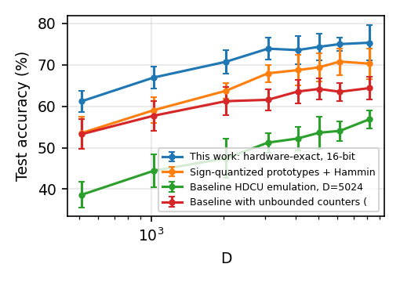

Memory and HDC-core cycles per inference implied by D (K = 5 prototypes, 1010 features, 2 cycles per 32-lane chunk with the synchronous SRAMs; CPU table copies not included):

| D | Prototype memory, 16-bit (KB) | Baseline prototypes, binary (KB) | Encode cycles (1010 BINDMAC) | Search cycles | Total core cycles |
|---|---|---|---|---|---|
| 512 | 5.0 | 0.31 | 32,320 | 160 | 32,512 |
| 1024 | 10.0 | 0.62 | 64,640 | 320 | 65,024 |
| 2048 | 20.0 | 1.25 | 129,280 | 640 | 130,048 |
| 3072 | 30.0 | 1.88 | 193,920 | 960 | 195,072 |
| 4096 | 40.0 | 2.50 | 258,560 | 1,280 | 260,096 |
| 5024 | 49.1 | 3.07 | 317,140 | 1,570 | 319,024 |
| 6144 | 60.0 | 3.75 | 387,840 | 1,920 | 390,144 |
| 8192 | 80.0 | 5.00 | 517,120 | 2,560 | 520,192 |

## Accuracy vs prototype lane width (5 classes, D = 5024)

| Lane width (bits) | Hardware-exact SWIFT |
|---|---|
| 4 | 20.0 ± 0.0 |
| 5 | 20.0 ± 0.0 |
| 6 | 20.0 ± 0.0 |
| 7 | 44.6 ± 6.9 |
| 8 | 60.4 ± 7.4 |
| 10 | 71.0 ± 3.2 |
| 12 | 73.2 ± 2.6 |
| 14 | 73.4 ± 2.9 |
| 16 | 73.6 ± 3.4 |
| 20 | 73.9 ± 2.8 |
| 24 | 73.9 ± 2.8 |
| 32 | 73.9 ± 2.8 |

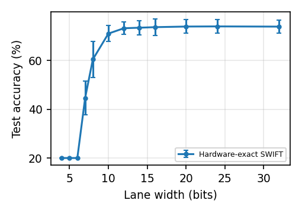

Wide-SPM size for D = 5024, 6 x 157 rows: 8-bit: 256 Kbit, 12-bit: 384 Kbit, 16-bit: 512 Kbit, 32-bit: 1024 Kbit.

## Retraining: accuracy and updates per epoch (5 classes, 16-bit lanes)

| Epoch | Validation acc. (%) | Test acc. (%) | Prototype updates per epoch |
|---|---|---|---|
| 0 | 73.6 ± 6.9 | 66.0 ± 2.5 | 0 |
| 1 | 80.6 ± 5.3 | 72.4 ± 3.6 | 72 |
| 2 | 81.5 ± 4.0 | 73.6 ± 3.3 | 49 |
| 3 | 81.5 ± 4.7 | 74.9 ± 2.7 | 24 |
| 5 | 81.5 ± 5.2 | 74.6 ± 2.6 | 10 |
| 10 | 81.3 ± 4.1 | 74.2 ± 1.9 | 7 |
| 15 | 81.5 ± 4.1 | 74.5 ± 1.8 | 0 |
| 20 | 81.7 ± 4.3 | 74.3 ± 1.7 | 0 |
| 30 | 81.7 ± 4.3 | 74.3 ± 1.7 | 0 |
| 40 | 81.7 ± 4.3 | 74.3 ± 1.7 | 0 |
| 50 | 81.7 ± 4.3 | 74.3 ± 1.7 | 0 |
| 60 | 81.7 ± 4.3 | 74.3 ± 1.7 | 0 |

Best-validation epoch: median 2; test accuracy at the selected epoch 74.3 ± 3.2 %. Epoch 0 = single-pass bundling (no retraining).

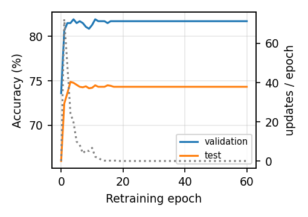

## Accuracy vs training-set size (5 classes, stratified subsets)

| Training clips used (%) | E. This work: hardware-exact, 16-bit lanes | G. Baseline HDCU emulation, D=5024 |
|---|---|---|
| 5 | 46.2 ± 3.8 | 36.8 ± 3.9 |
| 10 | 53.1 ± 5.3 | 41.0 ± 3.2 |
| 20 | 57.6 ± 4.1 | 47.2 ± 3.4 |
| 30 | 62.2 ± 3.6 | 44.1 ± 3.9 |
| 50 | 66.3 ± 2.8 | 49.0 ± 3.6 |
| 75 | 68.3 ± 3.0 | 50.6 ± 3.3 |
| 100 | 71.4 ± 3.5 | 54.8 ± 2.9 |

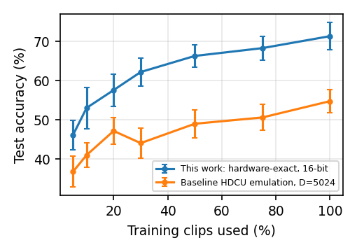

## Robustness to memory bit errors (5 classes, 16-bit lanes)

Bits flipped independently with probability BER: in the stored 16-bit normalized prototypes (all bits; sign bits only), in the query hypervector, and in the baseline's binary prototypes. Mean over seed sets and random trials.

| BER | SWIFT prototypes, any bit | SWIFT prototypes, sign flips | SWIFT query HV bits | Baseline binary prototypes |
|---|---|---|---|---|
| 0 | 74.3 ± 3.2 | 74.3 ± 3.2 | 74.3 ± 3.2 | 53.6 ± 3.8 |
| 1e-05 | 72.3 ± 3.8 | 74.3 ± 3.2 | 74.3 ± 3.2 | 53.6 ± 3.8 |
| 0.0001 | 56.9 ± 5.4 | 74.0 ± 3.0 | 74.3 ± 3.2 | 53.5 ± 3.9 |
| 0.001 | 38.8 ± 3.8 | 73.7 ± 3.1 | 74.1 ± 3.3 | 53.3 ± 3.1 |
| 0.003 | 32.4 ± 2.2 | 73.3 ± 3.3 | 74.0 ± 3.2 | 53.5 ± 3.1 |
| 0.01 | 26.5 ± 2.5 | 71.3 ± 2.3 | 74.0 ± 3.1 | 52.3 ± 2.8 |
| 0.03 | 23.3 ± 2.9 | 67.4 ± 3.0 | 73.3 ± 3.2 | 51.0 ± 2.3 |
| 0.1 | 21.7 ± 1.3 | 58.0 ± 4.1 | 72.2 ± 2.7 | 47.3 ± 1.7 |
| 0.2 | 20.9 ± 2.0 | 49.5 ± 2.7 | 69.3 ± 2.4 | 40.5 ± 2.2 |
| 0.3 | 21.1 ± 1.6 | 41.3 ± 4.5 | 63.6 ± 2.3 | 34.6 ± 2.7 |

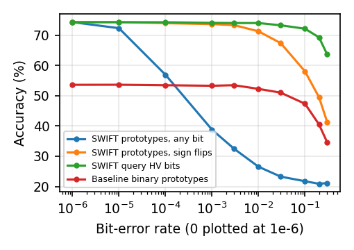

## Feature-group ablation (5 classes, 16-bit lanes)

| Configuration | Accuracy (%) | Δ vs all groups (points) |
|---|---|---|
| all | 74.3 ± 3.2 | +0.0 |
| without_base | 69.3 ± 2.5 | -5.1 |
| without_dx | 73.9 ± 3.7 | -0.4 |
| without_dy | 74.4 ± 1.9 | +0.1 |
| without_acd | 73.6 ± 2.4 | -0.7 |
| without_acx | 74.2 ± 2.3 | -0.2 |
| without_pct | 74.1 ± 2.4 | -0.2 |
| base_only | 71.3 ± 2.3 | -3.1 |
| w_base_1 | 75.1 ± 2.0 | +0.7 |

## Accuracy vs quantization levels (base group / other groups)

| Levels | Accuracy (%) |
|---|---|
| 5/5 | 74.1 ± 4.1 |
| 9/5 | 72.3 ± 2.5 |
| 11/11 | 74.1 ± 2.4 |
| 21/11 | 74.3 ± 3.2 |
| 21/21 | 74.3 ± 2.6 |
| 41/21 | 71.6 ± 3.2 |
| 63/31 | 72.6 ± 2.6 |

## Accuracy vs frames per clip (5 classes)

| Frames per clip | E. This work: hardware-exact, 16-bit lanes | G. Baseline HDCU emulation, D=5024 |
|---|---|---|
| 16 | 68.2 ± 2.9 | 50.9 ± 3.3 |
| 32 | 71.3 ± 2.8 | 53.1 ± 3.3 |
| 64 | 74.3 ± 3.2 | 53.6 ± 3.8 |

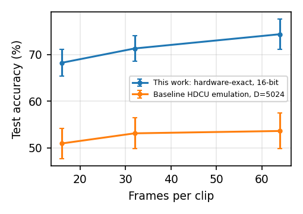

## Standard HDC benchmark: UCI HAR (6 classes, 561 features)

Official split: 6617 train / 735 validation / 2947 test; D = 5024, 64 quantization levels, 20 retraining epochs; 5 seed sets (classical classifiers: seed set 0 only). For comparison with other HDC hardware, which reports these datasets.

| Configuration | Accuracy (%) | Macro-F1 (%) |
|---|---|---|
| E. **This work: hardware-exact, 16-bit lanes** | 91.6 ± 0.4 | 91.4 ± 0.5 |
| E32. Hardware-exact, 32-bit lanes | 90.8 ± 0.4 | 90.5 ± 0.5 |
| F. Sign-quantized prototypes + Hamming search | 86.3 ± 1.3 | 86.1 ± 1.4 |
| K. OnlineHD (float, non-binary encoding) | 92.8 ± 0.3 | 92.6 ± 0.3 |
| G. **Baseline HDCU emulation**, D=5024 | 60.6 ± 1.5 | 60.9 ± 1.5 |
| SVM (RBF kernel) | 95.3 | 95.2 |
| MLP (1 hidden layer) | 94.5 | 94.5 |

## Standard HDC benchmark: ISOLET (26 classes, 617 features)

Official split: 5615 train / 623 validation / 1559 test; D = 5024, 64 quantization levels, 20 retraining epochs; 5 seed sets (classical classifiers: seed set 0 only). For comparison with other HDC hardware, which reports these datasets.

| Configuration | Accuracy (%) | Macro-F1 (%) |
|---|---|---|
| E. **This work: hardware-exact, 16-bit lanes** | 91.9 ± 0.5 | 91.8 ± 0.5 |
| E32. Hardware-exact, 32-bit lanes | 92.0 ± 0.5 | 91.9 ± 0.5 |
| F. Sign-quantized prototypes + Hamming search | 87.3 ± 0.4 | 87.1 ± 0.4 |
| K. OnlineHD (float, non-binary encoding) | 92.9 ± 0.2 | 92.9 ± 0.2 |
| G. **Baseline HDCU emulation**, D=5024 | 37.0 ± 2.2 | 31.4 ± 2.3 |
| SVM (RBF kernel) | 96.5 | 96.5 |
| MLP (1 hidden layer) | 95.8 | 95.7 |

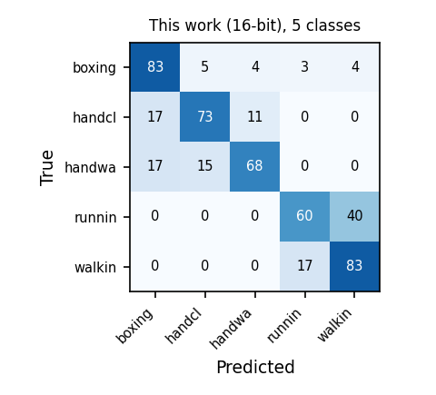

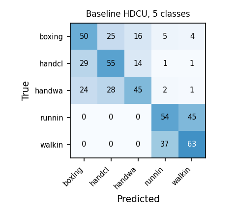

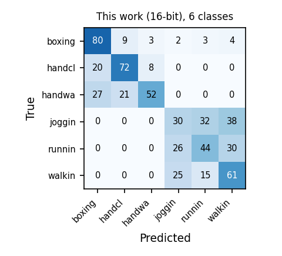

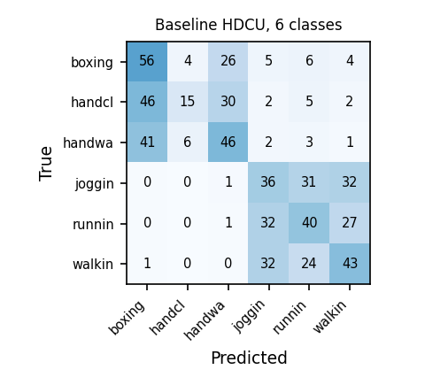

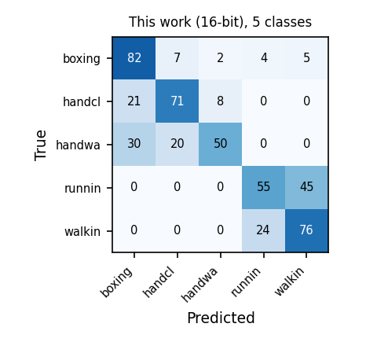

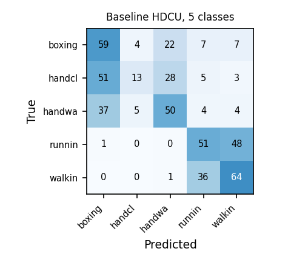

## Context: published KTH accuracy (6 classes, standard person split)

From the literature survey (reports/HDC accuracy metrics survey.md); positioning, not a like-for-like comparison:

| Method family | KTH accuracy (%) |
|---|---|
| Schuldt et al. 2004 (local features + SVM) | 71.7 |
| Lightweight: Dollar 2005 / Frequency Forest | 81.2 / 82.7 |
| Hand-crafted HOG/HOF, 3D-HOG, dense features (2008-2010) | 88.7–92.1 |
| Dense trajectories, ISA (2010-2011) | 93.9–95.5 |
| Action Bank (2012) | 98.2 |
| I3D features + SVM (2020) | 96.6 |
| Unsupervised spiking networks, STDP (2023) | 54.0–67.8 |

